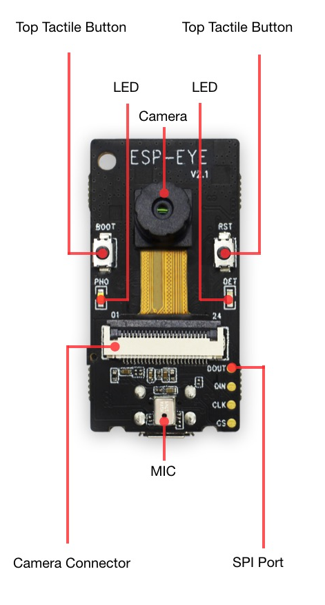
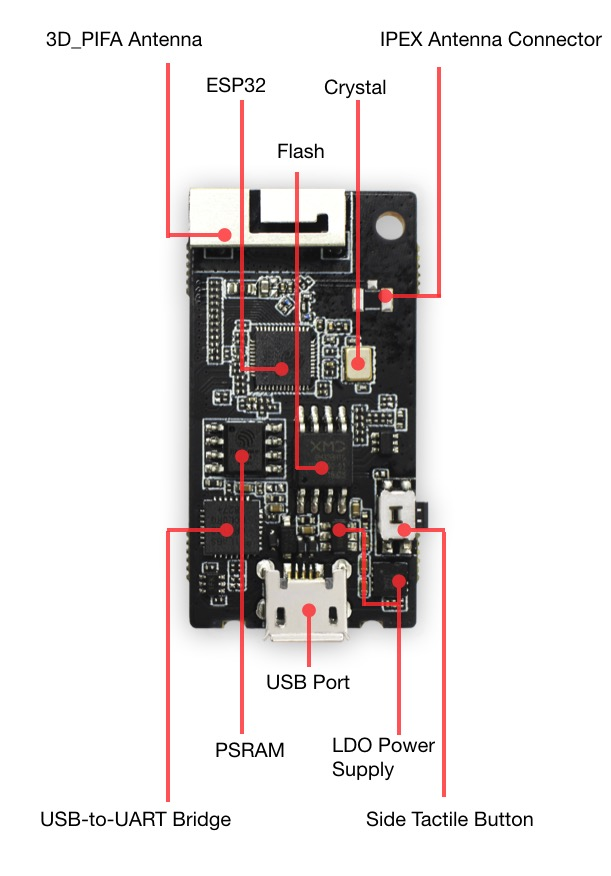

<h1 align="center">The ESP-EYE</h1>

Released in early 2019, the ESP-EYE was a milestone for Espressif's development boards, popular among DIY makers and edge-device developers. A newer board in the same line is the ESP32-S3-EYE, initially developed in late 2021, and so the ESP-EYE has since reached EOL.
<!-- S3-EYE date from first commit in repo, not retail launch -->
But What is it?
ESP-EYE is a development board for image recognition and speech signal processing, on which it integrates an on-board ESP32 chip, a 2 megapixel camera, and a digital microphone, 8MByte PSRAM and 4MByte flash. The board also supports image transmission via Wi-Fi and debugging through a Micro-USB port.

<h3>The Board</h3>
<p float="left">
    
    
</p>
<br clear="all">

<table>
<tr>
<td valign="top" width="50%">
<h3 align="center">Components</h3>
<ul>
<li>
<p dir="auto"><strong>3D_PIFA Antenna</strong></p>
<p dir="auto">A 3D PIFA antenna. With the R14 resistor users can select the external IPEX antenna, whereas with the R15 resistor they can select the 3D antenna.</p>
</li>
<li>
<p dir="auto"><strong>IPEX Connector</strong></p>
<p dir="auto">Used for connecting the external IPEX antenna. With the R14 resistor users can select the external IPEX antenna, whereas with the R15 resistor they can select the 3D antenna.</p>
</li>
<li>
<p dir="auto"><strong>ESP32 Chip</strong></p>
<p dir="auto">A 2.4 GHz Wi-Fi and Bluetooth combo chip.</p>
</li>
<li>
<p dir="auto"><strong>Crystal Oscillator</strong></p>
<p dir="auto">Provides an external clock to ESP32.</p>
</li>
<li>
<p dir="auto"><strong>Flash &amp; PSRAM</strong></p>
<p dir="auto">Provides memory for storing applications.</p>
</li>
<li>
<p dir="auto"><strong>CP2102 USB-to-UART Chip</strong></p>
<p dir="auto">Converts the USB signals to UART signals.</p>
</li>
<li>
<p dir="auto"><strong>USB Port</strong></p>
<p dir="auto">Provides power supply to the whole system.</p>
</li>
<li>
<p dir="auto"><strong>LDO Power Supply</strong></p>
<p dir="auto">Provides the required power supply to the ESP32 chip, camera and LED indicators.</p>
</li>
<li>
<p dir="auto"><strong>Side Tactile Button</strong></p>
<p dir="auto">A function key.</p>
</li>
<li>
<p dir="auto"><strong>Top Tactile Button</strong></p>
<p dir="auto">Reset/Boot button. We recommend that you do not configure this button for other uses.</p>
</li>
<li>
<p dir="auto"><strong>LED Indicators</strong></p>
<p dir="auto">The board has a red and a white indicator. Different flashing combinations of the red and white indicators reflect the different statuses of the board, e.g. waking up, networking, face detection, face recognition, face enrollment and face recognition.</p>
</li>
<li>
<p dir="auto"><strong>Camera</strong></p>
<p dir="auto">An external 2-Megapixel camera module for face detection, face recognition and Face ID enrollment.</p>
</li>
<li>
<p dir="auto"><strong>Camera Connector</strong></p>
<p dir="auto">Used for connecting the external camera.</p>
</li>
<li>
<p dir="auto"><strong>MIC</strong></p>
<p dir="auto">A digital microphone for voice control functions.</p>
</li>
<li>
<p dir="auto"><strong>SPI Port</strong></p>
<p dir="auto">A reserved port for data transmission.</p>
</li>
</ul>
</td>

<td td valign="top" width="50%">
<div align="right" width="50%">
<h3 align="center">Connections</h3>
<table align="center">
<thead>
<tr>
<th align="left">Interface</th>
<th align="center">Camera Pin</th>
<th align="center">ESP-EYE</th>
</tr>
</thead>
<tbody>
<tr>
<td align="left">SCCB Clock</td>
<td align="center">SIOC</td>
<td align="center">IO23</td>
</tr>
<tr>
<td align="left">SCCB Data</td>
<td align="center">SIOD</td>
<td align="center">IO18</td>
</tr>
<tr>
<td align="left">System Clock</td>
<td align="center">XCLK</td>
<td align="center">IO4</td>
</tr>
<tr>
<td align="left">Vertical Sync</td>
<td align="center">VSYNC</td>
<td align="center">IO5</td>
</tr>
<tr>
<td align="left">Horizontal Reference</td>
<td align="center">HREF</td>
<td align="center">IO27</td>
</tr>
<tr>
<td align="left">Pixel Clock</td>
<td align="center">PCLK</td>
<td align="center">IO25</td>
<td align="center">IO25</td>
</tr>
<tr>
<td align="left">Pixel Data Bit 0</td>
<td align="center">D2</td>
<td align="center">IO34</td>
</tr>
<tr>
<td align="left">Pixel Data Bit 1</td>
<td align="center">D3</td>
<td align="center">IO13</td>
</tr>
<tr>
<td align="left">Pixel Data Bit 2</td>
<td align="center">D4</td>
<td align="center">IO14</td>
</tr>
<tr>
<td align="left">Pixel Data Bit 3</td>
<td align="center">D5</td>
<td align="center">IO35</td>
</tr>
<tr>
<td align="left">Pixel Data Bit 4</td>
<td align="center">D6</td>
<td align="center">IO39</td>
</tr>
<tr>
<td align="left">Pixel Data Bit 5</td>
<td align="center">D7</td>
<td align="center">IO38</td>
</tr>
<tr>
<td align="left">Pixel Data Bit 6</td>
<td align="center">D8</td>
<td align="center">IO37</td>
</tr>
<tr>
<td align="left">Pixel Data Bit 7</td>
<td align="center">D9</td>
<td align="center">IO36</td>
</tr>
<tr>
<td align="left">Camera Reset</td>
<td align="center">RESET</td>
<td align="center">-1</td>
</tr>
<tr>
<td align="left">Camera Power Down</td>
<td align="center">PWDN</td>
<td align="center">-1</td>
</tr>
<tr>
<td align="left">Power Supply 3.3V</td>
<td align="center">3V3</td>
<td align="center">3v3</td>
</tr>
<tr>
<td align="left">Ground</td>
<td align="center">GND</td>
<td align="center">GND</td>
</tr>
</tbody>
</table>
</td>
</tr>
</table>

<br clear="all">

## Overview

This repository contains the code developed for a model to be trained, flashed and then executed on an ESP-EYE.

The repository contains:

- a very small ResNet-style classifier (about 30.5 thousand trainable parameters, about 9.5 million MACs per image);
- converters that build the dataset from public datasets (NYU Depth V2, COCO 2017);
- training, 8-bit quantization and evaluation scripts;
- the ESP-EYE firmware, and a PC tool to stream frames from the board, collect labelled images and evaluate the model live;

## Repository Structure

```text
thesis-project/
│
├── code/
│   ├── Arduino_side/          # firmware: ESP32-CAM, Arduino Mega, test sketches
│   ├── ML_model/              # dataset converters, training, quantization
│   ├── model_testing/         # evaluation scripts, PC capture and live-evaluation tool
│   └── preprocessing_scripts  # image processing scripts
│
├── data/                    # compressed in data.zip (too large for the repository)
│   ├── train/
│   │   ├── clear/
│   │   ├── center_blocked/
│   │   ├── left_blocked/
│   │   └── right_blocked/
│   └── val/
│       ├── clear/
│       ├── center_blocked/
│       ├── left_blocked/
│       └── right_blocked/
│
├── data_own/                # images captured with the ESP32-CAM (compressed .zip file)
│   └── val/
│       ├── clear/
│       ├── center_blocked/
│       ├── left_blocked/
│       └── right_blocked/
│
├── images/
│   └── readme/
│
├── model/
│   ├── not_quantized/       # float Keras model
│   └── quantized/           # int8 .tflite and model.h (C array for the firmware)
│
├── data.zip
├── requirements.txt
├── LICENSE
└── README.md
```

### Files and what they do

| File | Folder | Purpose |
|---|---|---|
| `nyu_preprocessing.py` | `code/preprocessing_scripts` | Converts the NYU Depth V2 labeled `.mat` into the four classes, labelling each frame from its depth map |
| `coco_preprocessing.py` | `code/preprocessing_scripts` | Converts COCO 2017 bounding boxes into the four classes |
| `ESP-EYE-Model.py` | `code/ML_model` | Defines and trains the network (Keras) |
| `ESP-EYE-Quantizing.py` | `code/ML_model` | 8-bit post-training quantization, writes the `.tflite` file and `model.h` |
| `test.py` | `code/model_testing` | Runs the int8 model on the PC on a folder, an image or a webcam |
| `models_evaluation.py` | `code/model_testing` | Accuracy, macro precision and recall, sizes of the float and int8 models |
| `esp_eye_capture.py` | `code/model_testing` | Receives frames from the board over USB, saves labelled images, live evaluation |
| `esp_eye_firmware.ino` | `code/Arduino_side` | ESP-EYE firmware: capture, inference, class byte over UART, frame streaming |

## Installation

Clone the repository:

```bash
git clone https://github.com/TomPotato/ESP-EYE.git
cd Thesis_TinyML_in_Practice
```

Install the Python dependencies (a virtual environment is recommended):

```bash
python -m venv venv
source venv/bin/activate        # Windows: venv\Scripts\activate
pip install -r requirements.txt
```

For the firmware you also need the **Arduino IDE** with:

- the Espressif **esp32** board package version, 2.0.1 used in the thesis;
- the TensorFlow Lite Micro Arduino library;

## Usage

To reproduce the experiments, follow these steps. The data folder with the converted dataset is available as `data.zip`; if you use it, you can skip steps 1 to 3.

### 1. Download and extract the public datasets

- **COCO 2017**: the `train2017` and `val2017` images and `annotations_trainval2017.zip` from <https://cocodataset.org>.
- **NYU Depth V2**: the *labeled* subset `nyu_depth_v2_labeled.mat` from <https://cs.nyu.edu/~fergus/datasets/nyu_depth_v2.html>.

### 2. Convert the datasets to the four classes

```bash
python nyu_preprocessing.py --mat nyu_depth_v2_labeled.mat --out_dir ./data_nyu --add_flips

python coco_preprocessing.py --ann annotations/instances_train2017.json --images train2017 --out_dir ./data_coco --max_per_class 2000 --add_flips
```

Both scripts write `train/` and `val/` folders and a `preview.png` contact sheet: look at it to check that the automatic labels are reasonable. All images are saved as $96 \times 96$ grayscale.

### 3. Merge the datasets
Create a new folder named data and drag and drop the train and val folders from both NYU and COCO into it to merge them. The images will not overlap, as they have different filenames.

Images captured with the ESP-EYE (see step 8) are added to the same class folders.

### 4. Train the model

```bash
python ESP-EYE-Model.py --data_dir data --epochs 40 --lr 1e-6 --out model/not_quantized/ReTINA_not_quantized.keras                                                          
```

The best model is saved as `ReTINA_not_quantized.keras`.

### 5. Quantize and convert

```bash
python Model_Quantizing.py --model model/not_quantized/tiny_resnet_not_quantized.keras --data_dir data --out_dir model/quantized                                                      
```

This writes the int8 `.tflite` file and `model.h`, the C array to be compiled into the firmware. The calibration images are taken from the dataset folder (see the note on the calibration set in the thesis).

### 6. Evaluate the models

```bash
python models_evaluation.py \
    --keras model/not_quantized/tiny_resnet_not_quantized.keras \
    --tflite model/quantized/tiny_resnet_obstacle_int8.tflite \
    --eval_dir data/val --device_ms 685
```

It prints the confusion matrices, per-class and macro precision and recall and the model sizes. `test.py` runs the int8 model on a folder (`--eval_dir`), a single image (`--image`) or a webcam (`--webcam`).

### 7. Deploy on the ESP32-CAM

1. Copy `model.h` next to `esp_eye_firmware.ino`.
2. In the sketch, modify  `CAMERA_ROTATE_180` if your camera is mounted upside down.
3. Arduino IDE: board *ESP-EYE*, **PSRAM enabled**. Flashing needs a USB-serial adapter with GPIO0 connected to GND during the upload (remove it afterwards).
4. At start-up the firmware prints how much of the tensor arena it uses, and where it was allocated (internal RAM or PSRAM).

The firmware sends the predicted class (0 to 3) as one byte on UART1 (GPIO14 on the AI-Thinker board) to the Arduino Mega.

### 8. Capture images and evaluate live (optional)

Close the Arduino Serial Monitor first, then:

```bash
python esp_eye_capture.py --port COM3 --out_dir ./data_own --subset val
```

Keys: `1`-`4` select the class, `s` saves a frame, `SPACE` saves bursts, `e` starts/stops the live evaluation (accuracy measured on the board), `q` quits.